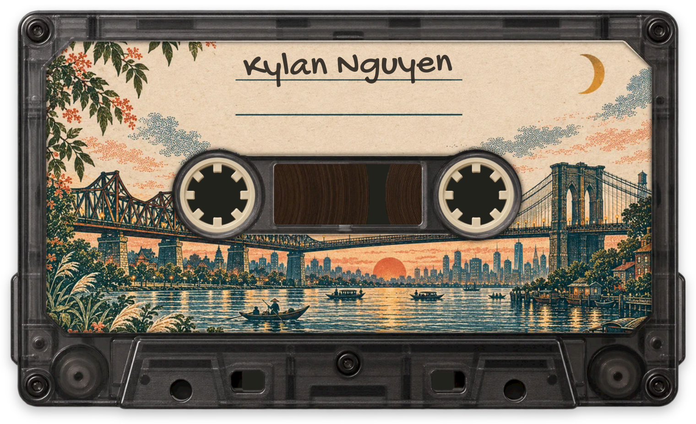

  

  <picture>
    <source media="(prefers-color-scheme: dark)" srcset="caption-dark.svg">
    
  </picture>

### Lately

Running coding agents on a fleet of remote machines, and building the tools to make that work:

- [agent-relay](https://github.com/hung-ng/agent-relay) passes messages and jobs between agents on different machines.
- [cobrowser](https://github.com/hung-ng/cobrowser) lets agents read my browser without touching my tabs.
- [mac-permissions](https://github.com/hung-ng/mac-permissions) holds anything an agent launches until I approve it.

### Before that

- [TinyCortex](https://github.com/hung-ng/TinyCortex), a neural guitar amp that runs on hand-written Metal shaders.
- [boxbox](https://github.com/hung-ng/boxbox), F1 live timing in the terminal.
- [swindlefish](https://github.com/hung-ng/swindlefish), a chess eval built for humans. It accounts for both players' ratings and clocks.
- [Clay Island](https://github.com/hung-ng/clay-island), a claymation god game with no art assets. Everything is generated in code. [Play it](https://clay-island.pages.dev/).
